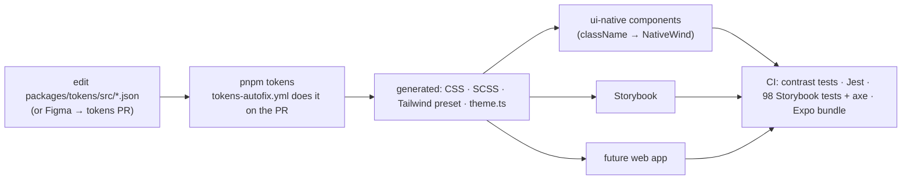

# Budget Counter — trip budgeting with daily allowances

> budget counter for business, leisure or every day life!

Split a trip budget into **one allowance per day**. Unspent money rolls into tomorrow; overspend is taken back from
tomorrow (_cascade_, default) or spread across the remaining days (_spread it out_). Log a spend in seconds — even split
one card payment into tagged parts — and watch today's number react.

This repository is a **first edition (MVP, "core loop")** built component-first:

- 📱 **React Native app** (Expo SDK 57, expo-router, NativeWind) — create trip → log/edit/split spends → today ring,
  days, summary, settings, light/dark, offline persistence.
- 🎨 **Design system** on **shadcn/ui + Radix** (via rn-primitives) with a **design-token pipeline**
  (W3C tokens → CSS · SCSS · Tailwind preset · typed theme) — change a token, everything follows.
- 📚 **Storybook** with every primitive, domain component, screen and the ten user flows as runnable `play` tests + axe a11y.
- ✅ **Tests for every flow** at four levels (unit, component/flow, Storybook, Maestro E2E) with the same F1–F10 numbering.
- 🚚 **CI/CD** for lint/type/test/Storybook, token drift, installable Android APK, emulator E2E, EAS, Pages deploy.
- 🌐 **Web build guide** for the React (shadcn/Radix) app that reuses the same core and tokens.

## Quick start

```bash
# Node 22+ (see .nvmrc) and pnpm 10 (corepack enable)
pnpm install
pnpm tokens          # (re)generate design tokens — normally already up to date
pnpm start           # Expo dev server → scan the QR with Expo Go, or press `a` for an Android emulator
pnpm storybook       # design system + flows on http://localhost:6006
pnpm test            # every Jest suite
```

No Android Studio? Get an installable APK from GitHub Actions ("Android APK" workflow) or `eas build --profile preview`.
Details for every option: **[docs/TESTING_ON_PHONE.md](docs/TESTING_ON_PHONE.md)**.

## What's in the box

```
packages/
  tokens/          Design tokens (DTCG JSON) → Style Dictionary → generated CSS/SCSS/Tailwind/TS
  core/            Platform-free domain: money, dates, allowance engine, forms, zustand store, hooks
  ui-native/       RN design system: shadcn-style primitives + domain components (NativeWind, CVA)
  screens-native/  The 7 screens + router-free MiniApp used by flow tests and Storybook
apps/
  mobile/          Expo app (routes are thin adapters) + Jest navigation tests + Maestro flows
  storybook/       Storybook 10 (react-native-web + Vite): docs, visual review, interaction + a11y tests
docs/              Architecture · Design system · Testing · Testing on a phone · Web build guide
.github/           CI, Storybook deploy, APK, E2E, EAS, token autofix, Chromatic, Dependabot
```

## Documentation

| Read                                                             | When                                                                                                            |
| ---------------------------------------------------------------- | --------------------------------------------------------------------------------------------------------------- |
| [docs/ARCHITECTURE.md](docs/ARCHITECTURE.md)                     | how the pieces fit, domain model, decisions & alternatives, roadmap hooks                                       |
| [docs/DESIGN_SYSTEM.md](docs/DESIGN_SYSTEM.md)                   | tokens, component inventory (shadcn ↔ rn-primitives), how to change a token, NativeWind v4 → v5/Uniwind mapping |
| [docs/TESTING.md](docs/TESTING.md)                               | the test pyramid, **flow matrix** (F1–F10 ↔ Jest ↔ Storybook ↔ Maestro), conventions, CI                        |
| [docs/TESTING_ON_PHONE.md](docs/TESTING_ON_PHONE.md)             | Expo Go, dev-client, APK (Actions/EAS/local), adb, Maestro, Play/TestFlight, device farms                       |
| [docs/WEB_BUILD_GUIDE.md](docs/WEB_BUILD_GUIDE.md)               | building the React web app on shadcn/ui + Radix with the same tokens and core                                   |
| [apps/mobile/.maestro/README.md](apps/mobile/.maestro/README.md) | running E2E flows                                                                                               |
| [CURSOR_CONTEXT.md](CURSOR_CONTEXT.md)                           | one-file briefing for an AI editor (Cursor): brief, decisions, rules, verified vs. unverified, next steps       |

The code itself is documented: every exported component and function has JSDoc (enforced by ESLint), which Storybook's
_Docs_ tab renders.

## Commands

| Command                                       | What it does                                                    |
| --------------------------------------------- | --------------------------------------------------------------- |
| `pnpm start` / `android` / `ios`              | Expo dev server                                                 |
| `pnpm tokens` / `pnpm tokens:check`           | regenerate tokens / fail if `generated/` is stale               |
| `pnpm lint` · `pnpm typecheck` · `pnpm test`  | across the workspace (Turborepo, cached)                        |
| `pnpm storybook` · `pnpm build-storybook`     | dev server / static site                                        |
| `pnpm --filter @tbc/storybook test:build`     | build Storybook and run all story `play` + axe tests headlessly |
| `pnpm check:maestro`                          | verify every Maestro `id:` exists as a `testID` in source       |
| `pnpm --filter @tbc/mobile e2e`               | Maestro flows against an installed build                        |
| `pnpm --filter @tbc/mobile export:check`      | prove Metro can bundle the Android app                          |
| `pnpm --filter @tbc/mobile build:apk:release` | local release APK (needs JDK 17 + Android SDK)                  |

## The design-change pipeline



Tokens are shared across platforms automatically; React Native and React _components_ are separate files kept in sync by a
parity checklist (see the web guide) — deliberately, as shadcn itself does.

## Status and honesty

- **Verified locally in the build environment:** token build + drift check + WCAG contrast tests, all Jest suites,
  ESLint (incl. JSDoc rule), TypeScript for every package, Storybook production build and the full story test run with
  axe, the Maestro selector guard, and an Android JS bundle export through Metro.
- **Written but _not_ executed here** (they need GitHub runners, an Android SDK/emulator, or third-party accounts): the
  APK build, the Maestro run on an emulator, EAS, Chromatic, Pages deploy. The workflows are valid YAML and use only
  commands that were run locally, but expect small fixes on their first real run.
- **Not built yet (by design):** the React web app (guide provided), Android home-screen widgets (the hero feature;
  `WidgetPreview` defines the data contract), cloud sync, receipt/bank import.
- Working title: _Budget Counter_. It is one constant (`APP_NAME` in `@tbc/core`) plus `app.json` to rename.

## Credits

Component structure follows [shadcn/ui](https://ui.shadcn.com) (MIT) on [Radix UI](https://www.radix-ui.com) semantics,
using [rn-primitives](https://github.com/roninoss/rn-primitives) and the patterns of
[react-native-reusables](https://github.com/founded-labs/react-native-reusables) (MIT) for React Native. Styling by
[NativeWind](https://www.nativewind.dev), variants by [CVA](https://cva.style), icons by [Lucide](https://lucide.dev),
tokens compiled by [Style Dictionary](https://styledictionary.com).
