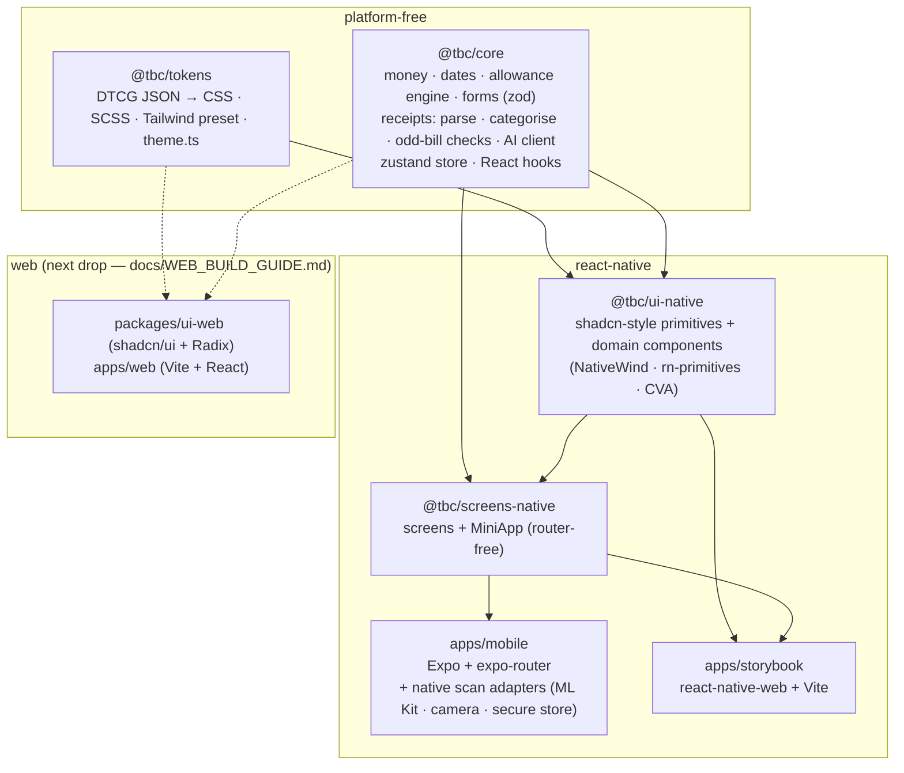
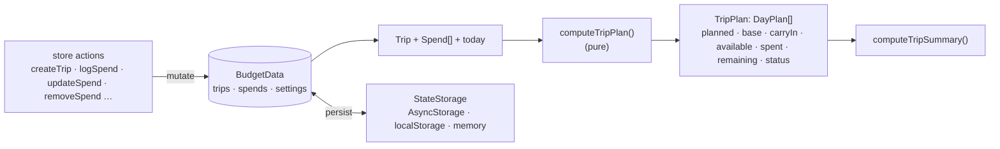
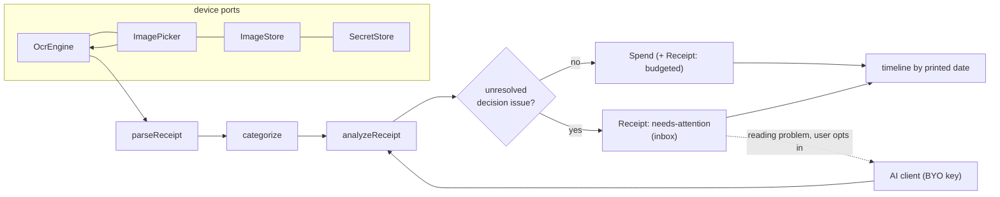

# Architecture

Budget Counter (working title) splits a trip budget into a **daily allowance**. Unspent money rolls into the next day;
overspend is taken back from the next day (`cascade`, default) or spread across the remaining days (`redistribute`).
The **core loop**: create a trip → log spends (optionally split into tagged parts) → watch today's allowance react →
review other days and a summary. On top of it sits **bill scanning**: photograph paper bills in the evening, read them
on-device (OCR), keep a JSON digital copy, count them against the budget in the background and file them on a timeline
by the date printed on the bill — see [RECEIPT_SCANNING.md](./RECEIPT_SCANNING.md).

The repo is a **pnpm + Turborepo monorepo**. The guiding idea: _domain logic and design tokens are platform-free;
each platform gets its own thin component layer._ That is what lets the web app be added later without rewriting
anything that matters.



Solid arrows exist today; dotted arrows are the web guide's target state.

## Packages

| Package               | Responsibility                                                       | Depends on                                                                                    | Notable choices                                                                                                       |
| --------------------- | -------------------------------------------------------------------- | --------------------------------------------------------------------------------------------- | --------------------------------------------------------------------------------------------------------------------- |
| `@tbc/tokens`         | Single source of truth for look & feel                               | Style Dictionary 5                                                                            | W3C DTCG JSON; 7 generated outputs; contrast + drift tests                                                            |
| `@tbc/core`           | Everything that isn't UI                                             | zustand, zod                                                                                  | Integer minor units; pure engine; store takes an injected `StateStorage`; device access only via `ScanServices` ports |
| `@tbc/ui-native`      | RN design system                                                     | tokens, core, rn-primitives, NativeWind, CVA, lucide                                          | shadcn naming, semantic classes only, a11y via `aria-*`                                                               |
| `@tbc/screens-native` | The 10 screens + `MiniApp`                                           | ui-native, core                                                                               | Screens take callbacks (`onCreateTrip`, `onOpenDay`), so they are router-agnostic and testable without expo-router    |
| `apps/mobile`         | Expo app, routes, providers, native config, **native scan adapters** | all of the above + expo-mlkit-ocr, image-picker, image-manipulator, file-system, secure-store | expo-router file routes are ~10-line adapters around screens; native modules are required lazily                      |
| `apps/storybook`      | Docs, visual review, flow tests                                      | all                                                                                           | Same components, on the web, with `play` tests + axe                                                                  |

TypeScript sources are consumed **directly** across packages (Metro, Vite and Jest all transpile workspace TS), so
there is no build step to forget and go-to-definition lands in source. The only build target is `@tbc/tokens`
(`turbo` runs it before lint/typecheck/test via `dependsOn: ["^build"]`).

## The domain (`@tbc/core`)



- **Nothing derived is stored.** Balances are recomputed from `(trip, spends, today)` on every read. Edit or delete a
  spend at any time and no stale carry-over can exist. Trips are days × budget — recomputing a plan is microseconds.
- **Money is an integer of minor units** (`Minor`); `splitEvenly` distributes remainders deterministically (the first
  days get the extra cent) so the sum of the daily allowances always equals the budget exactly.
- **Dates are ISO strings** (`YYYY-MM-DD`) — no timezone bugs, trivially serialisable; `today` is injected.
- **Overspend policies** are two branches inside one loop over the days; see the module doc in `allowance.ts`.
- **Split payments**: one card payment → several `Spend`s sharing a `splitGroupId`, each with its own tag. The engine
  never needs to know; summaries can regroup by `splitGroupId`.
- **Forms** (`forms.ts`) — `validateTripForm` / `validateSpendForm` take raw strings from the inputs and return either
  typed, minor-unit values or a field → message map (all problems at once, F2). Shared by RN today and the web app later.
- **Store**: `createBudgetStore({ storage })` returns a vanilla zustand store with `persist` (versioned, `migrate()` hook).
  Actions live under `state.actions` so their identity is stable and selectors never re-render because of them.
  `@tbc/core/react` supplies `BudgetProvider`, `useBudget(selector)`, `useBudgetActions()`, `useActivePlan()`,
  `useHydrated()` (via `useSyncExternalStore`) and friends.
- **Why zustand and not Redux/Context?** No boilerplate, selector-based re-rendering, works outside React (tests, the
  future widget bridge), first-class `persist`. **Why zod?** One schema gives validation, types and error messages for
  both platforms.

## Bill scanning (`@tbc/core/receipts`)



- **A receipt is data.** `ReceiptData` (schema v1) is plain JSON in integer minor units; a `Receipt` adds status, the day
  it is filed under, the raw OCR text and the photo URI. It lives in the same persisted store as trips and spends
  (`STORE_VERSION = 2`; `migrate()` fills in what v1 data lacks), next to `merchantRules` (corrections the user taught us); AI preferences and
  today's AI-call counter live in `settings`.
- **Still nothing derived is stored.** Issues (`NO_DATE`, `DUPLICATE`, …) are recomputed from `(data, trip, trips,
receipts, decisions)` every time, so editing a bill, a trip's dates or the "today" clock re-evaluates them.
- **One bill → one spend.** Budgeting a receipt calls the same `logSpend` as manual entry (with `receiptId`); a split
  reuses `splitGroupId`. The allowance engine does not know receipts exist.
- **Hybrid reading.** OCR runs first, always on-device. Only when the unresolved problems are about _reading_ does the
  review screen offer AI — after a per-use consent dialog, with a local daily cap, using the user's own API key held in
  secure storage. The user can always decline and type the missing fields.
- **Ports, not imports.** `ScanServices { ocr, picker, images, secrets, fetch? }` is the entire surface the domain and
  screens need from a device. `apps/mobile/src/scan` implements it with Expo modules; `createFakeScanServices` implements
  it for Jest and Storybook; a web app would implement it with the File API / Tesseract / IndexedDB. Screens obtain it
  from `ScanServicesProvider` / `useScanServices()`.

## The app (`apps/mobile`)

```
app/
  _layout.tsx        providers + Stack (modals: trip/new, spend/new, spend/[id]; scan; receipt/[id])
  (tabs)/            index (Today) · days · bills · summary · settings
  scan.tsx           camera / library / type-a-bill-in → live results
  receipt/[id].tsx   review one bill (issues, edit, AI, save / archive / delete)
  day/[date].tsx     a single day
  trip/new.tsx       create trip
  spend/new.tsx      log a spend (query: ?date=YYYY-MM-DD); splitting is a mode inside the form
  spend/[id].tsx     edit / delete
src/providers.tsx    store → hydration gate (holds the splash) → ScanServicesProvider → UIProvider (theme, safe area, portal)
src/store.ts         appStore = createBudgetStore({ storage: AsyncStorage })
src/scan/            native-services.ts (testable adapter logic over small port interfaces) · device.ts (lazy real modules)
```

Routes contain no business logic. Each is `<XScreen {...callbacks} />` with `router.push/back` wired in, so **screens
can be tested as flows without the router** (`MiniApp`, F1–F10) and the router wiring is tested separately
(`navigation.test.tsx`).

### Data flow for "log a spend"

1. `LogSpendScreen` holds the form as strings; `@tbc/core/forms` parses & validates → typed errors or minor units.
2. `actions.logSpend()` appends `Spend`s → store notifies subscribers → `persist` writes to AsyncStorage.
3. `useActivePlan()` selector re-runs `computeTripPlan` (memoised on `trips/spends/today`) → `AllowanceRing`,
   `DayCard`s and the overspend `Alert` update in the same frame.

## The design-system layer

See [DESIGN_SYSTEM.md](./DESIGN_SYSTEM.md). In one line: `tokens → CSS variables → Tailwind preset → NativeWind classes →
CVA variants → primitives → domain components → screens`. A token change propagates down that chain with no manual edits.

### "If the design system changes, both platforms update"

| Change                                  | Regenerated / affected                                                 | Automatic?                                                                                                                                                 |
| --------------------------------------- | ---------------------------------------------------------------------- | ---------------------------------------------------------------------------------------------------------------------------------------------------------- |
| A colour / radius / font token          | all `tokens.*`, preset, `theme.ts` → RN components, Storybook, web app | Yes: `pnpm tokens` (or `tokens-autofix.yml` on the PR); CI re-tests everything                                                                             |
| A component **variant** in `ui-native`  | RN + Storybook                                                         | Yes (same source)                                                                                                                                          |
| A component **API or structure** change | RN needs the edit; web component mirrors it                            | No — by design: the platforms' components are separate files. The mapping table in DESIGN_SYSTEM.md is the checklist; a future skill can automate the port |

That last row is the honest boundary: **tokens are shared, components are per-platform.** It's the same trade-off
shadcn itself makes (copy, don't depend), and it avoids the pitfalls of one-size-fits-all cross-platform component libs.

## Decisions and alternatives

| Decision             | Chosen                                 | Alternatives considered                       | Why                                                                                                         |
| -------------------- | -------------------------------------- | --------------------------------------------- | ----------------------------------------------------------------------------------------------------------- |
| Monorepo             | pnpm workspaces + Turborepo            | Nx, Yarn workspaces                           | lightest thing that gives caching + task graph; pnpm's strictness catches undeclared deps                   |
| Mobile framework     | Expo SDK 57 (managed + CNG)            | bare RN CLI                                   | config plugins keep `android/` disposable; EAS + Expo Go; still lets us add native widget code via prebuild |
| Routing              | expo-router                            | React Navigation directly                     | file-based, deep links for free (tested), web export possible                                               |
| Styling              | NativeWind 4 (Tailwind 3)              | Uniwind / NativeWind 5, Unistyles, StyleSheet | same class names as shadcn → same tokens; v5/Uniwind migration path documented and prepared                 |
| Behaviour primitives | rn-primitives                          | hand-rolled, Tamagui, gluestack               | is literally "Radix for RN"; unstyled, accessible, matches the shadcn mental model                          |
| State                | zustand + persist                      | Redux Toolkit, Jotai, MMKV-only               | see above; AsyncStorage keeps Expo Go compatibility (MMKV would need a dev build)                           |
| Docs                 | Storybook 10 (react-native-web-vite)   | Storybook RN on device                        | browsable/shareable, runs headless in CI with axe; on-device Storybook can be added                         |
| E2E                  | Maestro                                | Detox, Appium                                 | YAML, no instrumentation, works on both OSes                                                                |
| Text recognition     | `expo-mlkit-ocr` (on-device)           | cloud OCR, Tesseract/WASM, vision LLM for all | offline, free, no data leaves the phone; the LLM is a per-use fallback for what OCR can't read              |
| AI fallback          | BYO key, Gemini + OpenAI-compatible    | own backend/proxy from day one                | no server to run for the MVP; `ScanServices.fetch` can later point at a proxy that sells higher limits      |
| Web strategy         | RN complete first, web = guide (below) | react-native-web everywhere, Solito/Expo web  | user chose the RN-first drop; web guide compares both approaches                                            |

## Roadmap hooks already in place

- **Android widgets (2×2, 4×2)** — the hero feature. `WidgetPreview` defines the data contract (today's remaining +
  upcoming days). Implementation path: Expo config plugin or `react-native-android-widget`, reading the same persisted
  store snapshot; requires a dev build (not Expo Go).
- **Cloud sync / accounts** — the store already talks to an injected `StateStorage`; add a sync middleware or swap
  persistence for a repository interface. Versioned `migrate()` is there for schema changes.
- **Multi-currency / FX** — `Trip.currency` is per trip; money helpers are currency-aware (minor units per ISO code).
- **Bank/card feeds** — evaluated and dropped from the plan; scanning the paper bill replaced them as the way spends
  arrive without typing. `SplitPart` still models one payment → many tagged parts.
- **Paid AI tier / own proxy** — point `ScanServices.fetch` (and `AiSettings.baseUrl`) at a backend that holds the keys,
  meters usage and sells higher limits; the review UI and consent dialog stay as they are.
- **Re-parse after an upgrade** — `Receipt.rawText` is stored, so improving the parser can re-run old bills (not built yet).
- **i18n** — user-facing strings are centralised in `screens-native/src/lib/copy.ts` and `messages.ts`.
