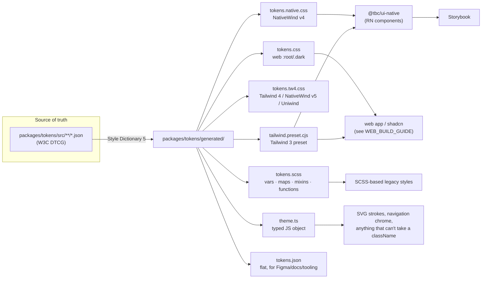
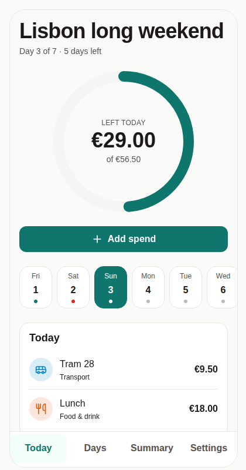
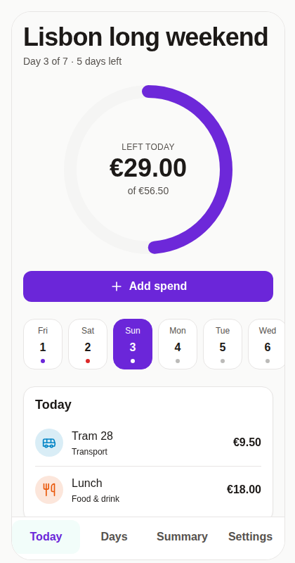

# Design system

> **Rule of the house:** we do not invent components. The primitives are the **shadcn/ui** set, built on the
> **Radix-for-React-Native** behaviour layer ([rn-primitives](https://github.com/roninoss/rn-primitives)) and styled with
> Tailwind classes via **NativeWind**. The look comes exclusively from **design tokens**. Change a token, and every
> platform follows.

The RN component layer follows the structure of [react-native-reusables](https://github.com/founded-labs/react-native-reusables)
(MIT), the community shadcn port for React Native; files are re-authored for this project and adapted (`aria-*`
semantics for react-native-web, `TextClassContext`, domain components, tokens from our pipeline). Credit where it's due.



## 1 · Design tokens

### Layers

| Layer                 | File(s)                                | Contains                                                                                                                                                 | Rule                                                                    |
| --------------------- | -------------------------------------- | -------------------------------------------------------------------------------------------------------------------------------------------------------- | ----------------------------------------------------------------------- |
| **Core** (primitives) | `src/core/*.json`                      | raw values: palette (stone, teal, red, amber, emerald, sky, …), spacing (4 px base), radius, font size / line height / weight, shadow, motion            | never referenced by components                                          |
| **Semantic**          | `src/semantic/light.json`, `dark.json` | _meaning_: `background`, `foreground`, `primary`, `destructive`, `success`, `warning`, `info`, `border`, `ring`, `tag-*` — each an alias to a core value | **this is what components use** (`bg-primary`, `text-muted-foreground`) |
| **Component**         | `src/component/size.json`              | decisions that outlive one component: 44 px touch target, control heights, icon sizes                                                                    | change here, not in each component                                      |

The semantic names are the shadcn vocabulary on purpose: any shadcn snippet, Figma kit or LLM prompt that says
`bg-card text-card-foreground` works unchanged. We add `success`, `warning`, `info` and seven category colours
(`tag-food` … `tag-other`).

Light and dark must define **exactly the same keys** (enforced by a test).

### Outputs and who consumes them

| Output                | Format                                                                                                                                         | Consumer                                                                                     |
| --------------------- | ---------------------------------------------------------------------------------------------------------------------------------------------- | -------------------------------------------------------------------------------------------- |
| `tokens.css`          | `:root { --primary: 175 77% 26%; … } .dark { … }` (HSL triplets so `hsl(var(--x) / <alpha>)` works)                                            | web apps, shadcn/ui, Storybook (`storybook.css`)                                             |
| `tokens.native.css`   | same variables, `.dark:root` selector (NativeWind v4 dark-mode convention)                                                                     | `apps/mobile/global.css`                                                                     |
| `tokens.tw4.css`      | Tailwind 4 flavour of the same variables                                                                                                       | NativeWind v5 / Uniwind / shadcn on Tailwind 4 (migration path, see §4)                      |
| `tailwind.preset.cjs` | Tailwind 3 preset: colours → `hsl(var(--x) / <alpha-value>)`, spacing, radius, fontSize, shadow, duration                                      | `packages/ui-native/tailwind.cjs`, web apps                                                  |
| `tokens.scss`         | `$color-*` primitives, `$semantic-light/-dark` maps, mixins `theme-light`, `theme-dark`, `root`, functions `semantic()`, `space()`, `radius()` | SCSS codebases, Sass colour maths                                                            |
| `theme.ts`            | typed `palette`, `spacing`, `radius`, `fontSize`, `size`, `themes.light/dark`, `getTheme()`                                                    | anything that cannot take a `className`: SVG strokes (AllowanceRing), navigation bar, splash |
| `tokens.json`         | flat name → {value, hex, description}                                                                                                          | docs, Figma import scripts, lint rules                                                       |

Using them:

```scss
// SCSS — needs Sass' NodePackageImporter (dart-sass ≥ 1.71; Vite/webpack sass-loader: `importers: [new NodePackageImporter()]`)
@use 'pkg:@tbc/tokens/scss' as t;
@include t.root; // emits :root + .dark variables
.chip {
  background: t.semantic(accent);
  padding: t.space(2);
  border-radius: t.radius(md);
}
```

```tsx
// React Native — 99 % of styling
<View className="rounded-lg border border-border bg-card p-4" />;

// React Native — when a className is impossible
const { colors } = useTheme();
<Circle stroke={colors.primary} />;
```

```js
// tailwind.config.js (web)
module.exports = {
  presets: [require('@tbc/tokens/tailwind-preset')],
  content: ['./src/**/*.{ts,tsx}'],
};
```

### Guard rails (run in CI)

- `pnpm tokens:check` fails when `generated/` is out of date with `src/` (the **drift guard**).
- WCAG contrast tests for ~24 foreground/background pairs in **both** themes (4.5 : 1 text, 3 : 1 graphics). A palette edit
  that hurts accessibility cannot merge.
- Sass compile test for `tokens.scss`, structural tests for CSS/preset/theme outputs.
- Raw palette colours are **not** exposed in the Tailwind preset — you can't write `bg-teal-700`; only semantic names.

### How to change a token (worked example)

Goal: make the brand colour indigo instead of teal.

1. Edit `packages/tokens/src/semantic/light.json` (and `dark.json`):
   ```json
   "primary": { "$value": "{color.indigo.700}" }
   ```
   If `indigo` isn't in the palette yet, add its ramp to `src/core/color.json` first.
2. `pnpm tokens` — regenerates all seven outputs.
3. `pnpm --filter @tbc/tokens test` — contrast tests tell you immediately if `primary-foreground` still passes on it.
4. `pnpm storybook` — every component and flow re-renders with the new colour (Storybook consumes `tokens.css`).
5. Open a PR. `tokens-autofix.yml` re-runs step 2 if you forgot it; `ci.yml` runs all Jest suites, the 98 Storybook
   tests with axe, and the Expo bundle against the new values.

**This was run, not just described.** Changing `primary` (`teal.700` → `violet.700`) and `ring` in `light.json` produced:

- `pnpm tokens:check` **failed** ("Generated tokens are stale: theme.ts, tokens.css, tokens.json, tokens.native.css,
  tokens.scss, tokens.tw4.css") — the drift guard working.
- `pnpm tokens` regenerated those six files; `tailwind.preset.cjs` is unchanged because it only references the variables.
- Token tests still passed (all 58, including contrast for both themes); the Storybook build and all 98 story + axe tests
  passed on the new colour.
- One brittle test surfaced — the SCSS test hard-coded the teal value — and was rewritten to derive the expectation from
  `tokens.json`, so it survives brand changes.

| Before (`teal.700`)                                              | After (`violet.700`)                                              |
| ---------------------------------------------------------------- | ----------------------------------------------------------------- |
|  |  |

The ring is an SVG coloured from `theme.ts` (JavaScript path) while the button, selected day and tab label are
class-driven (`bg-primary`, `text-primary`, CSS-variable path): both updated from the single edit. The change was then
reverted; the repo ships with the teal brand.

Nothing else is touched by hand: the app icon background in `app.json` (`adaptiveIcon.backgroundColor`) and the splash
colours are the only literal hex values outside tokens; they're OS-level config that can't read CSS variables.

### Figma ↔ tokens

`tokens.json` and the DTCG source are compatible with **Tokens Studio** (export as W3C DTCG) and Figma's native
Variables (import via the REST API/`figma-variables` plugins). The intended loop: designer edits variables in Figma →
plugin opens a PR against `packages/tokens/src` → `tokens-autofix` regenerates → CI verifies. Set-up is a follow-up; the
file format is ready for it.

## 2 · Components

### Primitives (shadcn/ui → rn-primitives)

| shadcn/ui         | Radix → RN behaviour          | Ours (`@tbc/ui-native`)                                                      | Variants / notes                                                                                                                                             |
| ----------------- | ----------------------------- | ---------------------------------------------------------------------------- | ------------------------------------------------------------------------------------------------------------------------------------------------------------ |
| Button            | — (Pressable)                 | `Button`                                                                     | `default` `destructive` `outline` `secondary` `ghost` `link` × `default` `sm` `lg` `icon`; ≥ 44 px                                                           |
| Card              | —                             | `Card` `CardHeader` `CardTitle` `CardDescription` `CardContent` `CardFooter` | title renders `aria-level` 2                                                                                                                                 |
| Badge             | —                             | `Badge`                                                                      | `default` `secondary` `destructive` `outline` `success` `warning` `info`                                                                                     |
| Alert             | —                             | `Alert`                                                                      | `default` `destructive` `success` `warning` `info`, optional icon                                                                                            |
| Alert Dialog      | `@rn-primitives/alert-dialog` | `AlertDialog*` + `ConfirmDialog`                                             | `ConfirmDialog` = the one-liner used for destructive confirmations                                                                                           |
| Input             | — (TextInput)                 | `Input`                                                                      | `invalid` state                                                                                                                                              |
| Label             | `@rn-primitives/label`        | `Label`                                                                      | press focuses control                                                                                                                                        |
| Form field        | —                             | `Field`                                                                      | label + description + error wiring (`aria-describedby`, `aria-invalid`)                                                                                      |
| Progress          | `@rn-primitives/progress`     | `Progress`                                                                   | `decorative` when a text label already says it                                                                                                               |
| Radio Group       | `@rn-primitives/radio-group`  | `RadioGroup`, `RadioGroupItem`, `RadioCard`                                  | `RadioCard` for "cascade / spread it out"                                                                                                                    |
| Separator         | —                             | `Separator`                                                                  | horizontal / vertical                                                                                                                                        |
| Skeleton          | —                             | `Skeleton`                                                                   | pulse                                                                                                                                                        |
| Switch            | `@rn-primitives/switch`       | `Switch`                                                                     |                                                                                                                                                              |
| Tabs              | `@rn-primitives/tabs`         | `Tabs*` + `SegmentedControl`                                                 | segmented control = tabs without panels                                                                                                                      |
| Toggle Group      | `@rn-primitives/toggle-group` | `ToggleGroup*`                                                               | single-choice chips (tag picker)                                                                                                                             |
| Typography        | `Slot`                        | `Text`                                                                       | `default` `h1` `h2` `h3` `lead` `body` `small` `caption` `muted` `numeric` (tabular figures); `TextClassContext` lets parents (Button, Badge) set text style |
| Icon              | —                             | `Icon`                                                                       | wraps `lucide-react-native`, styled via className                                                                                                            |
| _(not in shadcn)_ | —                             | `Stepper`                                                                    | ± counter, native-feeling replacement for `<input type=number>`; documented as the one shadcn-less primitive                                                 |

### Domain components (composed from the primitives)

| Component              | Purpose                                                                                  | Key props                                                       |
| ---------------------- | ---------------------------------------------------------------------------------------- | --------------------------------------------------------------- |
| `AllowanceRing`        | the hero: today's remaining vs spent as an SVG ring, status colour from the engine       | `remaining`, `available`, `spent`, `status`, `currency`, `size` |
| `MoneyText`            | one place that formats minor units; tabular figures; tones                               | `amount`, `currency`, `signed`, `compact`, `size`, `tone`       |
| `AmountInput`          | large currency-aware numeric entry (text in, parsed to minor units by `@tbc/core` forms) | `value`, `onChangeText`, `currency`, `invalid`                  |
| `SpendRow`             | a logged spend (icon, note, tag, amount)                                                 | `spend`, `currency`, `onPress`                                  |
| `DayCard`              | day summary in the Days list                                                             | `day`, `currency`, `selected`, `onPress`                        |
| `WeekStrip`            | 7-day radiogroup with status dots                                                        | `days`, `selectedDate`, `onSelect`                              |
| `CategoryBar`          | stacked spend-by-tag bar + legend                                                        | `total`, `currency`                                             |
| `StatTile`             | label / value / hint                                                                     | `label`, `value`, `hint`, `tone`                                |
| `TagIcon`, `TagPicker` | category glyph and chooser                                                               | `tag`, `value`, `onValueChange`, `compact`                      |
| `EmptyState`           | icon + title + description + CTA                                                         | `icon`, `title`, `description`, `action`                        |
| `WidgetPreview`        | in-app preview of the future 2×2 / 4×2 Android widgets                                   | `size`, `today`, `upcoming`                                     |

Layout helpers (`Screen` with safe-area edges and optional scrolling, `ScreenHeader`) live in `layout.tsx`; `UIProvider` / `useTheme` in `theme/theme.tsx`.

### Authoring rules

1. **Compose, don't fork.** Need a new control? Look for the shadcn/Radix equivalent first and add it via rn-primitives.
2. **Variants with CVA.** No ad-hoc `if (variant === …)` styling; add the variant to the `cva()` and Storybook shows it.
3. **Only semantic classes.** `bg-destructive`, never `bg-red-600` (the preset doesn't even expose it).
4. **Full class strings** — Tailwind's scanner can't see `` `bg-${tone}` ``. Use maps (`STATUS_STYLES`, `TAG_CLASSES`).
5. **`className` last** in `cn()` so callers can override (`tailwind-merge` resolves conflicts).
6. **a11y is part of the API.** Roles, `aria-*`, ≥ 44 px targets, focus ring on web. Storybook fails on axe violations.
7. **JSDoc on every exported component and function**, with `@example` where non-obvious. ESLint (`jsdoc/require-jsdoc`)
   enforces it; the docs on Storybook's _Docs_ tab are generated from it.
8. **Story per component** with Controls, plus a `play` test when it has behaviour.

## 3 · Storybook

`pnpm storybook` → http://localhost:6006. It renders the _React Native_ components on the web through
`react-native-web` + Vite (`@storybook/react-native-web-vite`), with NativeWind compiled by PostCSS and the same
`tokens.css` variables as the app.

| Section                   | What's in it                                                                                                                                               |
| ------------------------- | ---------------------------------------------------------------------------------------------------------------------------------------------------------- |
| **Introduction**          | philosophy, how to consume, links                                                                                                                          |
| **Foundations**           | Colors (light/dark swatches with contrast), Typography, Spacing & Radius, Elevation & Motion — all read from `tokens.json`/`theme.ts`, so they can't drift |
| **Primitives**            | one entry per row of the primitive table                                                                                                                   |
| **Domain**                | one entry per domain component (+ states: over, near-limit, empty, loading)                                                                                |
| **Screens / Overview**    | each app screen with seeded data                                                                                                                           |
| **Flows / User journeys** | F1–F10 with `play` functions — executable documentation                                                                                                    |

Toolbar: theme switch (light / dark), a11y panel, Controls, Interactions. The theme switch just toggles NativeWind's
colour scheme, so both palettes are reviewable without touching the OS.

`pnpm build-storybook` produces a static site (`apps/storybook/storybook-static`); `storybook-deploy.yml` publishes it to
GitHub Pages on `main`.

## 4 · NativeWind: v4 today, v5 / Uniwind tomorrow

**Why NativeWind at all.** It lets the _same Tailwind class names_ drive RN and web, so the shadcn mental model and the
token preset carry over one-to-one. The alternative — hand-written `StyleSheet` + a JS theme — works, but every shadcn
snippet would need translating, and the token → style step becomes bespoke code we own.

**Choice made here: NativeWind 4.2 + Tailwind 3.4**, because it is the stable, widely deployed combination that
react-native-reusables and rn-primitives document, and it works with Expo SDK 57 and Storybook (via the `nativewind`
JSX runtime).

### Token mapping

| Token concept      | Tailwind 3 / NativeWind v4 (in use)                                                                    | Tailwind 4 / NativeWind v5 / Uniwind (prepared)                                                                   |
| ------------------ | ------------------------------------------------------------------------------------------------------ | ----------------------------------------------------------------------------------------------------------------- |
| Colours            | preset `colors: { primary: 'hsl(var(--primary) / <alpha-value>)' }` + variables in `tokens.native.css` | `@theme inline { --color-primary: hsl(var(--primary)); … }` + variables in `tokens.tw4.css`                       |
| Dark mode          | `.dark:root { … }` variables; `darkMode: 'class'`; `useColorScheme().setColorScheme()`                 | `.dark { … }` variables (same names); declare `@custom-variant dark (&:where(.dark, .dark *));` in your CSS entry |
| Radius / font size | preset `theme.borderRadius/fontSize` from the tokens                                                   | `--radius-*`, `--text-*` (+ `--text-*--line-height`) in `@theme inline` (emitted in `tokens.tw4.css`)             |
| Spacing            | preset `theme.spacing` (4 px scale)                                                                    | Tailwind 4's default 4 px `--spacing` already matches; nothing to emit                                            |
| Config             | `tailwind.config.js` factory in `@tbc/ui-native/tailwind`                                              | CSS-first: theme/preflight/utilities imports + `@import '@tbc/tokens/css/tailwind4';` (no config file)            |
| Metro              | `withNativeWind(config, { input: './global.css', inlineRem: 16 })`                                     | v5: `withNativewind(getDefaultConfig(__dirname))`; Uniwind: `withUniwindConfig`                                   |
| Babel / JSX        | `nativewind/babel` preset (`jsxImportSource: 'nativewind'`)                                            | removed in v5 — plain `babel-preset-expo`                                                                         |
| Runtime colours    | `useTheme()` reading `themes` from `theme.ts`                                                          | unchanged                                                                                                         |

Because component code only uses semantic class names, **switching engines changes config, not components**. The
migration checklist:

1. Emit `tokens.tw4.css` (already generated on every `pnpm tokens`).
2. Upgrade to `tailwindcss` 4 (+ `@tailwindcss/postcss`), `nativewind@5` and `react-native-css`; add `postcss.config.mjs`
   with `"@tailwindcss/postcss": {}`; replace `global.css` with the v5 entry (`@import "tailwindcss/theme.css" layer(theme); …
@import "nativewind/theme";`) plus `@import '@tbc/tokens/css/tailwind4';`; delete `tailwind.config.js`.
3. Metro: `withNativewind(getDefaultConfig(__dirname))`; Babel: drop `nativewind/babel` / `jsxImportSource`.
4. Run the Storybook suite (98 tests + axe) — it is the safety net for visual regressions.
5. Re-run `apps/mobile` Jest (`navigation.test.tsx`) and Maestro F0–F10.

> **Status check (29 Sep 2026):** NativeWind **5.0.0-rc.0** (with `react-native-css` 3.1.0-rc.0, Tailwind 4.1.x) was
> published on 13 Sep 2026; the maintainers describe roughly two weeks of bug-fix-only community testing before
> promoting it to `latest`, and a v4 → v5 migration guide exists ([nativewind.dev/v5/guides/migrate-from-v4](https://www.nativewind.dev/v5/guides/migrate-from-v4)).
> That is why this MVP ships on the stable v4 line and keeps v5 one `pnpm tokens` away. **Uniwind** is the other
> Tailwind-4-native option. Re-check both before migrating; no code in `ui-native` needs to change because components
> only use semantic class names. The v5 removals to plan for: `cssInterop`/`remapProps` → `styled` (the only use is the
> `cssInterop(IconImpl, …)` call in `primitives/icon.tsx`), and theme overrides go through `Appearance.setColorScheme()`
> (used once, in `UIProvider`).

### Things that bit us (so they don't bite you)

- `className` → styles conversion on the web is handled by NativeWind's `$$css` path; Vite needs
  `jsxImportSource: 'nativewind'` (configured in `.storybook/main.ts`).
- In Jest, NativeWind's `setColorScheme` throws unless the css-interop dark-mode flag is set; `jest/setup.js` does it.
- `react-native-css-interop`'s `doctor.js` is CJS-only and breaks the production Vite build → stubbed by a tiny Vite
  plugin in `.storybook/main.ts`.
- RN Web ignores `accessibilityState` → use `aria-*` (see `docs/TESTING.md`).
