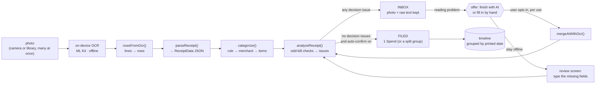

# Receipt scanning

The evening ritual: you collected paper bills all day; at night you photograph each one. The app reads it, stores a
**digital version** (a JSON document, see [the schema](#the-bill-json)), counts it against the trip budget in the
background, and files it on a **timeline** under the date printed on the bill. Anything odd — a bill from another day,
a total that could not be read, a bill that looks scanned twice — is _asked about_ instead of silently guessed.



## Design rules

1. **Offline first.** Scanning, parsing, categorising, budgeting and the timeline need no network and no account.
2. **AI is an escape hatch, never a default.** It is offered only when the problem is about _reading_ (`NO_TOTAL`,
   `NO_DATE`, `DATE_AMBIGUOUS`, `LOW_CONFIDENCE`, `ITEMS_MISMATCH`, `NO_MERCHANT`) — not when the question is about
   _intent_ (is this the right day?). Every use is confirmed in a dialog that names the provider and says the photo
   leaves the phone. Choosing "I'll fill it in" is always available and keeps everything on the device.
3. **The bill is data, not a picture.** The photo is kept (re-encoded to JPEG, ≤ 1800 px) so you can check the numbers,
   but everything the app does reads the JSON. The raw OCR text is kept too, so a future parser can be re-run.
4. **One spend per bill; splitting is optional.** A bill becomes one `Spend`. When the line items clearly mix categories
   and add up to the total, the review screen _offers_ a split (reusing the existing split-payment model).
5. **Ask only when needed.** A clean bill from today is filed without a prompt. The timeline is the record of what
   happened; the inbox is the to-do list.

## The bill JSON

`ReceiptData` (`packages/core/src/receipts/types.ts`, `schemaVersion: 1`). Money is integer minor units, dates are ISO.
Every field except `items`, `source`, `confidence` and `schemaVersion` is optional because OCR may not find it.

```jsonc
{
  "schemaVersion": 1,
  "source": "ocr", // "ocr" | "ai" | "manual"
  "merchant": "SPAR Ljubljana",
  "vatId": "SI12345678",
  "date": "2026-10-16", // printed purchase day
  "dateAmbiguous": false, // true when 04/05/2026 could be 4 May or 5 April
  "dateAlternatives": [], // other plausible days (swapped reading, a second printed date)
  "time": "18:42",
  "currency": "EUR",
  "total": 1847, // 18.47 EUR
  "subtotal": 1514,
  "tax": 333,
  "tip": 0,
  "items": [
    { "description": "Mleko 1L", "quantity": 2, "unitPrice": 129, "amount": 258, "tag": "food" },
    { "description": "Kruh", "amount": 189 },
  ],
  "paymentMethod": "card", // "card" | "cash"
  "receiptNumber": "0042-17",
  "confidence": 0.86, // 0–1 heuristic: how much of the bill we understood
}
```

A stored `Receipt` wraps that JSON with the user's decisions:

| Field                    | Meaning                                                                                    |
| ------------------------ | ------------------------------------------------------------------------------------------ |
| `id`, `tripId`           | identity; the trip it is counted against (`null` = none)                                   |
| `status`                 | `needs-attention` (inbox) → `budgeted` (counted) or `archived` (digital copy only)         |
| `data`                   | the `ReceiptData` above                                                                    |
| `date`                   | the day it is filed under on the timeline (the printed date unless the user chose another) |
| `tag`                    | main category (`food`, `transport`, `stay`, … the same tags as manual spends)              |
| `rawText`, `imageUri`    | raw OCR text and local photo URI                                                           |
| `acknowledged`           | issue codes the user accepted ("yes, that really is the right date")                       |
| `scannedAt`, `updatedAt` | ISO timestamps                                                                             |

Issues are **derived, never stored**: `analyzeReceipt(data, ctx, decisions)` is a pure function, so the scan screen, the
review screen, tests and Storybook all give the same answer.

## Odd-bill rules

Severity decides behaviour: a `decision` blocks counting until the user answers; `warning` and `info` are shown but never
block. Defaults: `staleDays = 1`, `LOW_CONFIDENCE = 0.6`.

| Code                | Severity        | Trigger                                                                                                            | What the user can do                                                             |
| ------------------- | --------------- | ------------------------------------------------------------------------------------------------------------------ | -------------------------------------------------------------------------------- |
| `NO_TRIP`           | decision        | no active trip and none chosen                                                                                     | create a trip, or keep the bill as a digital copy                                |
| `NO_TOTAL`          | decision        | total not found                                                                                                    | type it, or finish with AI                                                       |
| `NO_DATE`           | decision        | no printed date                                                                                                    | pick a day (today / nearest trip day), or finish with AI                         |
| `DATE_FUTURE`       | decision        | printed date after today                                                                                           | pick a day                                                                       |
| `DATE_OUTSIDE_TRIP` | decision        | printed date outside the trip's dates                                                                              | move to another trip that contains the date, pick a trip day, or keep as archive |
| `DATE_NOT_TODAY`    | info → decision | date is before today. **Info** when ≤ 1 day old (or the trip is over / the user waived it); **decision** otherwise | confirm "yes, this is from {date}" or choose another day                         |
| `DATE_AMBIGUOUS`    | decision        | day/month order cannot be settled from the format, the trip window or the locale                                   | choose one reading, or finish with AI                                            |
| `MULTIPLE_DATES`    | info            | more than one date printed                                                                                         | shown for awareness                                                              |
| `DUPLICATE`         | decision        | same shop (or minute) + same day + same total as a saved bill; receipt numbers, when both exist, override          | "count it anyway" or delete                                                      |
| `CURRENCY_MISMATCH` | decision        | bill currency ≠ trip currency                                                                                      | type the amount in the trip currency                                             |
| `LOW_CONFIDENCE`    | decision        | `confidence < 0.6`                                                                                                 | review fields, or finish with AI                                                 |
| `NO_MERCHANT`       | warning         | no shop name                                                                                                       | optional: type one (and "remember for this shop")                                |
| `ITEMS_MISMATCH`    | warning         | line items do not add up to the total                                                                              | informational; splitting is not offered                                          |

The parser is deliberately European-heavy (the first users travel there): it reads total / date / tax labels in several
languages, month names, decimal comma vs. point and grouped thousands, and currency markers. The word lists live in
`receipts/locale.ts`; the bundled sample bills in `receipts/fixtures.ts` cover Slovenia, Germany, Italy, the UK, the US,
Spain, Croatia and Czechia plus a taxi and a hotel bill. Add a language by extending `locale.ts` and adding a fixture.

### Categorising

Strongest first: **a rule you taught** ("remember for this shop") → **merchant keywords** (`hotel`, `spar`, `taxi` …) →
**the category most line items point to** → `other`. All offline and deterministic; correcting a category and ticking
"remember" writes a `merchantKey → tag` rule.

## Hybrid OCR: engines and ports

All device access sits behind `ScanServices` (`@tbc/core`):

| Port      | Contract                                                         | Phone adapter (`apps/mobile/src/scan`)                       | Test double (`@tbc/core/testing`) |
| --------- | ---------------------------------------------------------------- | ------------------------------------------------------------ | --------------------------------- |
| `ocr`     | `isSupported() → Promise<boolean>`, `recognize(uri) → OcrResult` | `expo-mlkit-ocr` (Google ML Kit text recognition, on-device) | `fixtureOcr(...)`                 |
| `picker`  | `capture() → uri \| null`, `pick() → uri[]`                      | `expo-image-picker` (camera + multi-select library, ≤ 30)    | scripted queue                    |
| `images`  | `persist(uri)`, `remove(uri)`, `encodeForAi(uri)`                | `expo-image-manipulator` + `expo-file-system`                | in-memory map                     |
| `secrets` | `get(key)`, `set(key, value)`, `remove(key)`                     | `expo-secure-store`                                          | in-memory map                     |
| `fetch?`  | injected `fetch` for AI calls                                    | global `fetch`                                               | scripted responses                |

- Native modules are required **lazily** (`apps/mobile/src/scan/device.ts`), so creating the services loads nothing and
  Jest/Storybook never touch native code.
- `expo-mlkit-ocr` is a native module: it works in a **development build**, not in Expo Go. In Expo Go the app still
  saves photos (to the inbox, with a notice) and every bill can be completed by hand. See
  [TESTING_ON_PHONE.md](./TESTING_ON_PHONE.md).
- iOS: `app.json` sets `expo-build-properties` → `ios.deploymentTarget: "16.4"` (the library asks for 16.0, SDK 57's
  plugin refuses anything below 16.4) and `useFrameworks: "static"` (the library README says ML Kit's pods need it), and
  `iosEngine: "auto"` (Apple Vision where ML Kit cannot link, e.g. arm64-only simulators). `expo prebuild` for both
  platforms was run and generates the permission strings; an actual iOS build was **not** run (no macOS here).

## The AI fallback

Implemented in `receipts/ai.ts` with two plain `fetch` calls and no SDKs.

| Provider          | Default model         | Endpoint                                                           | Notes                                                                                                                                                   |
| ----------------- | --------------------- | ------------------------------------------------------------------ | ------------------------------------------------------------------------------------------------------------------------------------------------------- |
| Google Gemini     | `gemini-flash-latest` | `…/v1beta/models/{model}:generateContent`, key in `x-goog-api-key` | Has a free tier with daily limits. **On the free tier Google may use submitted content to improve its products** — the settings card says so.           |
| OpenAI-compatible | `gpt-4o-mini`         | `{baseUrl}/chat/completions`                                       | Pay-as-you-go on OpenAI. We have **not** confirmed a free API tier; change the base URL to use any compatible service, including ones with a free tier. |

**Bring your own key** for this MVP: the key is stored in the device's secure store under `tbc.ai.apiKey` — never in the
persisted zustand state, never logged. The later "paid models with higher limits" step is a different `ScanServices.fetch`
target (the app's own proxy) and needs no UI change.

### Limits and failure modes

- A **local daily cap** (`settings.ai.dailyLimit`, default 20) protects the free tier. Usage is counted **only on success**;
  it resets when the date changes.
- Errors map to specific messages and recoveries (`AiError.code`): `NOT_CONFIGURED`, `NO_KEY`, `LIMIT_REACHED`,
  `RATE_LIMITED` (with `retryAfterSec`), `UNAUTHORIZED`, `MODEL_NOT_FOUND`, `NETWORK`, `BAD_RESPONSE`, `HTTP`.
  Every failure leaves the bill untouched and offers "fill in by hand".
- **Models are retired regularly.** A 404 becomes `MODEL_NOT_FOUND` with "pick another model in AI settings". Free-tier
  quotas and model names change; check the provider's current docs before shipping.
- The model's reply is **never trusted**: the JSON is extracted from any code fences, validated with zod, coerced to minor
  units, restricted to supported currencies, and re-checked by the same odd-bill rules. `mergeAiWithOcr` keeps OCR values
  the AI did not contradict, and the review screen shows the result for confirmation.
- The photo sent is a smaller copy (≤ 1280 px, JPEG q0.7).

## UX map

| Screen (route)               | Purpose                                                                                                                                                   |
| ---------------------------- | --------------------------------------------------------------------------------------------------------------------------------------------------------- |
| **Bills** (tab)              | Inbox ("needs you"), the **timeline** grouped by printed date, archive; "Scan bills" button                                                               |
| **Scan** (`/scan`)           | Camera or multi-select library. Each photo shows a live result row: _Counted · €18.47 · Food · Fri 16 Oct_ or _Needs you_ with the reason                 |
| **Review** (`/receipt/[id]`) | Photo, issue cards (pick a date, move trip, "count anyway"), editable merchant / total / category / day, optional split, AI card, save / archive / delete |
| **Settings → Bills & AI**    | Auto-file clean bills on/off; AI provider, key, model, base URL, daily limit, usage today                                                                 |

Deep link: `budgetcounter://receipt/{id}`; an unknown id shows a "bill not found" state.

## Testing

| Layer                                           | Where                                                                                                   |
| ----------------------------------------------- | ------------------------------------------------------------------------------------------------------- |
| Parser / categoriser / analyser / pipeline / AI | `packages/core/src/receipts/*.test.ts` (fixtures for DE, SL, HR, IT, ES, … in `fixtures.ts`)            |
| Store (receipts, rules, AI usage)               | `packages/core/src/store/receiptStore.test.ts`                                                          |
| Components                                      | `packages/ui-native/src/domain/receipts.test.tsx`                                                       |
| Flows F11–F15                                   | Jest `packages/screens-native/src/flows.bills.test.tsx` · Storybook `Flows / Bills`                     |
| Phone adapters                                  | `apps/mobile/__tests__/native-services.test.ts` (fake ports), `navigation.test.tsx` (routes, deep link) |

Flows: **F11** evening scan — clean bills file themselves · **F12** an odd date asks, and the answer decides the day ·
**F13** outside the trip — move it, re-date it, or keep a copy · **F14** an unreadable bill — fill it in offline, or let
AI finish it · **F15** the Bills tab (timeline, inbox, copies) and Bills & AI settings. Maestro flows for these are not part of this drop (the real camera and ML Kit need a device); the
`check:maestro` guard still protects existing ids.

## Known limits

- OCR quality depends on the photo; crumpled thermal paper and handwriting will land in the inbox — by design.
- Thermal receipts fade; the stored photo is the only long-term copy (there is no cloud backup yet).
- Multi-currency bills ask for the converted amount; there is no FX lookup.
- iOS is configured but only Android is built in CI.
